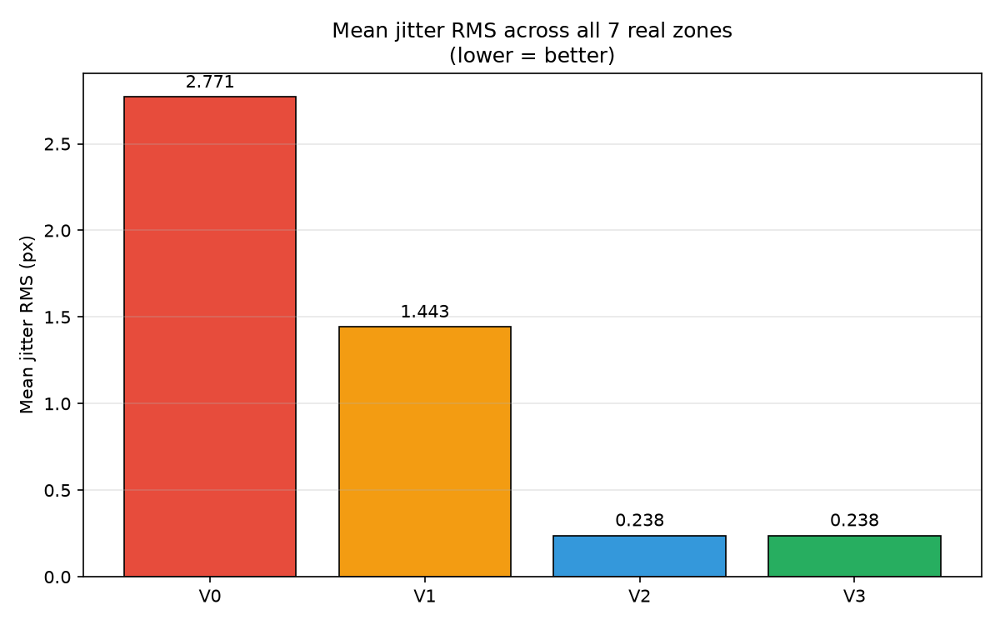
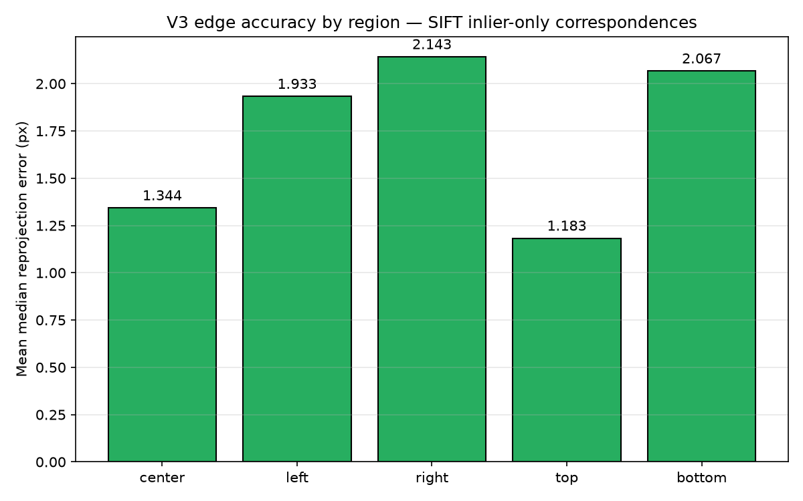
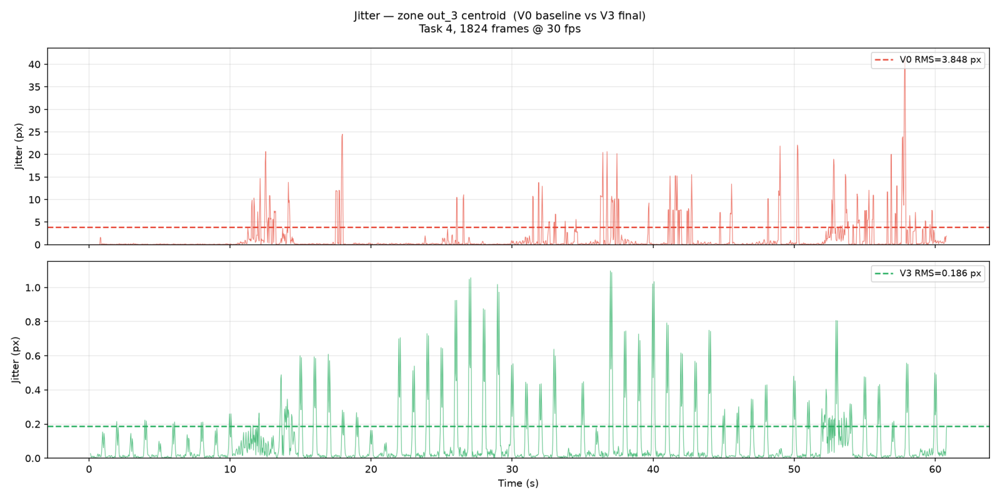
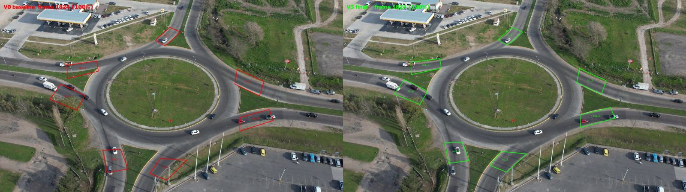

# Compensación de movimiento de cámara y edición de zonas E/S

Este documento describe dos funcionalidades del procesamiento de video de SIAT:

- **Compensación de movimiento de cámara** (issue #19): las zonas de entrada/salida (E/S) definidas por el usuario siguen a la escena aunque la cámara (por ejemplo, un dron) se desplace, rote o vibre.
- **Edición de zonas E/S** (issue #15): mover, redimensionar, renombrar, cambiar color y duplicar zonas ya dibujadas.

Incluye el problema, el diseño elegido, las alternativas evaluadas y descartadas, la metodología de medición y los resultados obtenidos sobre un video real.

---

## 1. Compensación de movimiento de cámara

### 1.1 Problema

El usuario dibuja las zonas E/S sobre el **primer frame** del video (frame de referencia). El conteo de vehículos se basa en detectar cuándo el centro de la caja de un vehículo entra en una zona de entrada y luego en una de salida.

Si la cámara se mueve (viento, vibraciones, deriva de un dron), la escena se desplaza en la imagen pero las zonas quedan fijas en coordenadas de pantalla. En el video de prueba la cámara llega a desplazarse ~160 px y rotar ~1,75° al final de un minuto, por lo que las zonas terminan sobre pasto o sobre otra calle. Consecuencias:

- Conteos de transiciones erróneos (entradas/salidas no detectadas o asignadas a otra vía).
- Visualización incorrecta en el video procesado y en la pantalla de revisión.

### 1.2 Enfoque general

Se estima, para cada frame `t`, una transformación geométrica entre el frame de referencia y el frame actual. Esa transformación se usa en dos sentidos:

| Uso | Sentido | Propósito |
|-----|---------|-----------|
| Pertenencia a zonas | actual → referencia | El centro de cada vehículo se lleva a coordenadas del frame de referencia antes de evaluar si está dentro de una zona. |
| Dibujo | referencia → actual | Los polígonos de las zonas (y de las zonas excluidas) se deforman para dibujarse sobre la escena actual. |

Como la escena vista por un dron es aproximadamente un **plano** (el suelo), la relación entre dos vistas del mismo plano es una **homografía** (matriz 3×3, transformación proyectiva).

### 1.3 Algoritmo final

El procesamiento se hace en **dos pasadas** sobre el video (el procesamiento es offline, por lo que se puede mirar el video completo antes de dibujar):

**Pasada 1 — precálculo del movimiento** (`MotionCompensator.pre_compute`, sin YOLO):

1. Cada frame se reduce a escala 0,5 y se convierte a escala de grises (menor costo de CPU).
2. **Seguimiento frame a frame:** se detectan puntos característicos (`goodFeaturesToTrack`) y se siguen al frame siguiente con flujo óptico piramidal de Lucas-Kanade. Como el desplazamiento entre frames consecutivos es pequeño, la estimación es precisa.
3. Con esas correspondencias se ajusta una homografía con **RANSAC** (`findHomography`). RANSAC descarta como valores atípicos los puntos que se mueven distinto del fondo, como los vehículos, que funcionan así como una máscara implícita.
4. Las homografías entre frames consecutivos se **encadenan** (producto de matrices) para obtener la transformación referencia → frame `t`.
5. **Re-anclaje periódico:** cada `CAMERA_MOTION_ANCHOR_INTERVAL` frames (30 por defecto) se vuelve a estimar la transformación directamente contra el frame de referencia con ORB, para cortar la deriva acumulada del encadenamiento.
6. **Suavizado temporal de fase cero:** se proyectan las 4 esquinas del cuadro con cada homografía, se suavizan sus trayectorias con un filtro gaussiano (σ = 1,5 frames) aplicado hacia adelante y hacia atrás, y se recalcula la homografía a partir de las esquinas suavizadas (`getPerspectiveTransform`). Al ser de fase cero, no introduce retraso respecto del movimiento real.
7. Las matrices se reescalan a resolución completa: `H_full = S⁻¹ · H_scaled · S`, con `S = diag(s, s, 1)`.

**Pasada 2 — inferencia YOLO + tracking:** para cada frame se obtiene la transformación ya calculada (búsqueda O(1)) y se usa para la pertenencia a zonas y el dibujo. Los polígonos se dibujan con precisión subpíxel (`shift=4`, 1/16 px) y antialiasing (`LINE_AA`).

### 1.4 Datos generados y visualización en el frontend

El worker genera `camera_motion.json`, que se sube a MinIO junto con los demás resultados. Su clave queda en la columna `inference.url_camera_motion` (migración `20261029_01`) y la API la expone como `cameraMotionUrl` en la respuesta de la tarea.

El archivo contiene, por frame, la matriz referencia → actual y un campo `convention` que documenta el sentido de la transformación. El frontend (`frontend/src/lib/camera-motion.ts`) acepta tanto matrices 3×3 (formato actual) como 2×3 (formato anterior), por compatibilidad con tareas ya procesadas.

En la pantalla **Revisar**, los polígonos SVG se deforman con la matriz del frame que se está mostrando. El frame exacto se obtiene con `video.requestVideoFrameCallback` (`frame = round(mediaTime · fps) + 1`, donde el frame 1 es el de referencia). Si el navegador no lo soporta, se usa como respaldo `requestAnimationFrame` con `currentTime`. Las tareas sin `camera_motion.json` muestran las zonas fijas, como antes.

### 1.5 Configuración

| Variable | Valor por defecto | Descripción |
|----------|-------------------|-------------|
| `CAMERA_MOTION_COMPENSATION` | `true` | Activa o desactiva la compensación. |
| `CAMERA_MOTION_SCALE` | `0.5` | Factor de reducción del frame para estimar el movimiento. |
| `CAMERA_MOTION_SMOOTH_SIGMA` | `1.5` | Sigma del suavizado gaussiano, en frames. |
| `CAMERA_MOTION_ANCHOR_INTERVAL` | `30` | Cada cuántos frames se re-ancla contra el frame de referencia. |

La variable `CAMERA_MOTION_DEADBAND_PX` de la primera versión ya no se usa.

### 1.6 Metodología de evaluación

**Video de prueba:** video aéreo de dron sobre una rotonda, 1920×1080 a 30 fps, 1824 frames (60,8 s), con las 7 zonas reales definidas por el usuario (4 de entrada y 3 de salida).

**Métricas:**

- **Temblor (jitter):** RMS de la segunda diferencia temporal de la posición de los vértices de cada zona deformada, en píxeles a resolución completa. Mide cambios bruscos de un frame a otro; un movimiento suave de la cámara da valores cercanos a cero.
- **Precisión:** error de reproyección mediano, en píxeles, de correspondencias independientes entre el frame de referencia y el frame `t`. Se obtienen con SIFT, test de razón de Lowe (r = 0,75) y RANSAC (umbral 3 px), y se usan solo los inliers, es decir, el fondo estático. Se informa por regiones del cuadro, incluidos los bordes.
- **Costo:** milisegundos por frame de la estimación de movimiento, en CPU.

> **Nota metodológica.** Una primera versión de la métrica de precisión usaba todas las correspondencias ORB, incluidas las de vehículos en movimiento. Eso inflaba el error (34–57 px) y lo hacía inconsistente entre corridas. Restringirla a inliers de fondo estático con SIFT dio valores estables y comparables entre variantes.

### 1.7 Experimentos y resultados

| Variante | Descripción | Temblor RMS (px) | Precisión mediana (px) | ms/frame |
|----------|-------------|------------------|------------------------|----------|
| V0 | Afín 2×3 contra referencia + zona muerta de 2 px (primera versión) | 2,771 | 4,760 | 11,9 |
| V1 | Homografía encadenada con error de re-anclaje | 1,443 | 42,930 | 11,6 |
| V2 | Homografía encadenada corregida + suavizado por coeficiente | 0,238 | 1,476 | 12,0 |
| **V3** | **Homografía encadenada corregida + suavizado por esquinas (final)** | **0,238** | **1,476** | **11,9** |

V3 frente a V0: **−91,4 % de temblor** y **−69,0 % de error de precisión**, con el mismo costo computacional.

**Temblor por zona:**

| Zona | Ubicación aproximada | V0 | V1 | V2 | V3 |
|------|----------------------|----|----|----|----|
| in_1 | arriba | 1,617 | 1,146 | 0,103 | 0,103 |
| in_2 | derecha | 3,348 | 1,162 | 0,125 | 0,125 |
| in_3 | abajo | 3,561 | 1,705 | 0,375 | 0,375 |
| in_4 | izquierda | 2,181 | 1,577 | 0,280 | 0,280 |
| out_1 | izquierda | 1,623 | 1,423 | 0,192 | 0,192 |
| out_2 | abajo | 3,217 | 1,779 | 0,404 | 0,404 |
| out_3 | borde derecho | 3,848 | 1,310 | 0,186 | 0,186 |

Las zonas cercanas a los bordes del cuadro eran las que más temblaban en V0. Esto es consistente con que el modelo afín no captura la perspectiva y el error crece hacia los bordes.

**Decisiones por experimento:**

- **V0 (descartada).** Se identificaron cuatro causas del temblor:
  1. Cada frame se estimaba de forma independiente contra un frame de referencia lejano, así que cada estimación traía ruido no correlacionado.
  2. La zona muerta de 2 px producía saltos cuando el movimiento rondaba el umbral.
  3. El modelo afín no representa la perspectiva.
  4. Los vértices se redondeaban a píxel entero al dibujar.
- **V1 (descartada).** El encadenamiento frame a frame redujo el temblor, pero después de cada re-anclaje ORB el frame previo se reiniciaba al de referencia en lugar del frame actual. Así, el paso siguiente estimaba referencia → `t+1` y lo encadenaba sobre referencia → `t`, duplicando el desplazamiento cada 30 frames. Corregido usando siempre el frame actual como previo.
- **V2 (reemplazada).** Cumple el objetivo de precisión (≤ 3 px), pero suaviza cada coeficiente de la matriz por separado, lo que no es geométricamente válido para homografías.
- **V3 (final).** Suaviza las trayectorias de las esquinas y recalcula la homografía. En este video da los mismos números que V2 porque las matrices están cerca de la identidad, pero sigue siendo correcto con movimientos grandes o lentes de gran angular.

### 1.8 Limitaciones

- **Sacudidas muy bruscas o desplazamientos muy grandes:** si el flujo óptico pierde los puntos entre dos frames o ORB no encuentra coincidencias con la referencia (por ejemplo, desplazamientos > 300 px a escala 0,5), la estimación de ese tramo se degrada.
- **Escenas con poca textura** (niebla, noche, superficies uniformes): hay menos puntos característicos y la estimación es menos robusta.
- **Escena no plana:** la homografía supone que la escena es un plano. Objetos altos (edificios, postes) cerca de la cámara presentan paralaje que el modelo no representa. En tomas aéreas a altura normal el efecto es despreciable.
- **Vehículos muy lentos:** el enmascarado de vehículos es implícito (RANSAC). Vehículos casi detenidos pueden comportarse como fondo; el suavizado temporal atenúa ese sesgo. En el video de prueba hubo entre 705 y 857 correspondencias de fondo por frame.
- **Costo:** la primera pasada decodifica el video una vez más (~12 ms/frame en CPU), un costo menor frente a la inferencia YOLO.

### 1.9 Archivos involucrados

| Archivo | Rol |
|---------|-----|
| `backend/app/modelo/motion_compensator.py` | Estimación, encadenamiento, re-anclaje y suavizado de la homografía. |
| `backend/app/modelo/process.py` | Integración en el pipeline: precálculo, pertenencia a zonas, dibujo subpíxel y escritura de `camera_motion.json`. |
| `backend/app/command/process_command.py` | Subida de `camera_motion.json` a MinIO. |
| `backend/app/alembic/versions/20261029_01_camera_motion_url.py` | Columna `inference.url_camera_motion`. |
| `backend/app/services/task_service.py` | Expone `cameraMotionUrl` en la respuesta de la tarea. |
| `frontend/src/lib/camera-motion.ts` | Aplicación de matrices 2×3/3×3 a polígonos. |
| `frontend/src/routes/tarea/[id]/revisar/+page.svelte` | Deformación de las zonas por frame y sincronización con `requestVideoFrameCallback`. |
| `backend/app/tests/test_motion_compensator*.py`, `test_camera_motion_upload_and_warp.py` | Pruebas unitarias (55). |

---

## 2. Edición de zonas E/S

### 2.1 Problema

Una zona mal dibujada solo se podía corregir borrándola y volviendo a dibujarla, y no había forma de crear zonas similares rápidamente.

### 2.2 Funcionalidad

En la pantalla de configuración de la tarea (`/tarea/<id>/configurar`):

| Acción | Cómo se usa |
|--------|-------------|
| Mover | Activar el modo **Mover/Redimensionar**, seleccionar una zona y arrastrarla. Las coordenadas se limitan al cuadro. |
| Redimensionar | En el mismo modo, arrastrar los vértices (círculos blancos) de la zona seleccionada. |
| Renombrar | Ícono de lápiz en la tarjeta de la zona. Enter confirma; Escape cancela. |
| Cambiar color | Muestra de color en la tarjeta (selector de color nativo). |
| Duplicar | Ícono de copia en la tarjeta. Crea una copia desplazada un 3 % con el sufijo "(copia)". |

### 2.3 Decisiones de diseño

- **Modo de edición explícito:** mover y redimensionar se activan con un botón para no interferir con el flujo existente de dibujo por 4 clics.
- **Color solo en el frontend:** el modelo `Road` no tiene campo de color y el color no afecta el análisis, por lo que no se persiste.
- **Geometría como funciones puras:** las operaciones (`movePolygon`, `moveVertex`, `duplicatePolygon`, `isPointInPolygon`, `nearestVertexIndex`) están en `frontend/src/lib/polygon-utils.ts`, separadas de la interfaz y listas para probarse cuando el frontend tenga un framework de pruebas.
